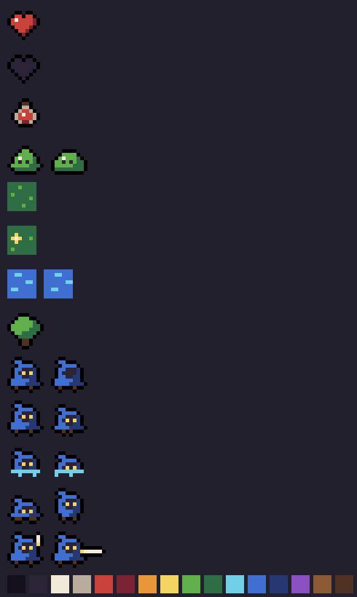

# Simplicity Art Style

Simplicity is a fantasy RPG drawn as tiny, readable icons. Every sprite should read at a glance, at 8×8 pixels, against any background. When a detail doesn't help someone recognise the thing, leave it out.



## The grid

- Every sprite is an **8×8 cell**. Characters, enemies, items and tiles all use the same cell.
- Attack frames may extend sideways in whole cells (16×8) to fit a weapon. Nothing grows taller than 8.
- Sprites face **right**. The game mirrors them for left. Don't draw left-facing art.
- Leave the bottom row for feet or the base of the shape, so everything stands on the same ground line.
- Scale only by whole numbers with nearest-neighbour filtering. Never rotate a sprite or resize it by a fraction.

## Outline

- Sprite files contain **no outline**. The game, and `tools/build.py` for previews, draws a 1 px `ink` outline around every solid pixel (4-neighbour).
- Leave at least one empty pixel between a sprite and anything you don't want outlined as a separate shape.
- Water and other effect colours marked `nooutline` in the palette stay soft-edged.

## Tiles

- Ground tiles (`!tile` in the sprite file) fill the whole 8×8 cell and are **never outlined**.
- Ground stays dark and quiet: a `pine` base with a few `moss` flecks. Bright colours are reserved for things you can interact with.
- Obstacles like trees are ordinary outlined sprites drawn on top of a ground tile, and they fill their cell so collision matches the art.

## Palette

16 colours, defined in [`palette/simplicity.txt`](palette/simplicity.txt). Never use a colour that isn't in the palette. If a new colour seems necessary, add it to the palette first and justify it.

| Role | Colours |
|---|---|
| Outline, voids | `ink` `void` |
| Light and metal | `bone` `stone` |
| Fire, danger, health | `ember` `blood` `amber` |
| Light sources, eyes, gold | `glow` |
| Nature | `moss` `pine` `oak` `bark` |
| Water, magic | `mana` `azure` `deep` `arcane` |

## Shape and character

- **Creatures, not people.** No skin, noses, mouths, fingers or hair. A character is a silhouette with eyes.
- **Faces are voids.** A face is a `void` opening with two `glow` (or other bright) eye pixels. Eyes always face the direction of travel.
- **No hands.** Weapons and tools float beside the body.
- **One big shape.** The body is a single bold mass (a hood, a blob, a shell). Limbs are at most single-pixel nubs, like the Wanderer's feet.
- **Top-heavy and leaning back.** Heads or hoods take up about half the height. A tip or point trailing back gives a sense of direction.

## Colour per sprite

- Aim for **3 or 4 palette colours** per sprite, with **5 as the ceiling**. The outline and any held weapon don't count.
- Shade with two tones of one hue: base on the left and top, the darker partner (`azure`/`deep`, `moss`/`pine`, `ember`/`blood`, `oak`/`bark`) on the right and bottom. Light comes from the top-left.
- One `bone` highlight pixel on the top-left of round or shiny things (slimes, potions, gems). Don't add more than one.

## Animation

- **1 to 3 frames.** Two is the default. Motion comes from shifting the whole shape by one pixel, not from redrawing it.
- Typical frame times: idle 500 ms, walk 220 ms, swim 320 ms, jump 300 ms, attack 200 ms.
- Standard set for every playable or humanoid creature:

| Animation | Frames | What changes |
|---|---|---|
| idle | 2 | Blink: the eyes become `void` |
| walk | 2 | Body bobs up 1 px, feet step inward |
| swim | 2 | Only head and eyes above a `water` line; bob 1 px |
| jump | 2 | Squash (1 px shorter, wider base), then stretch (narrow, feet tucked) |
| fight | 2 | Weapon raised beside the body, then a 16-wide thrust |

## Authoring

Sprites are plain text in `art/`, one file per entity. One character is one pixel, `.` is transparent, and letters come from the palette.

```
@idle 500        # animation name, ms per frame
.BB.....
..BBBB..
...              # 8 rows per frame; a blank line starts the next frame
```

Run `python tools/build.py` (needs Pillow). It checks every frame against the grid and the palette, then writes the game sheets and previews to `build/`.
