# Simplicity

**A solo game jam entry: a one-hour fantasy RPG built in 72 hours.** It plays in 2D and looks like a late-90s 3D game, with chunky low-poly models and PlayStation-style rendering, right in the browser.

**▶ Play it: https://dominicabrooks.github.io/Simplicity/**

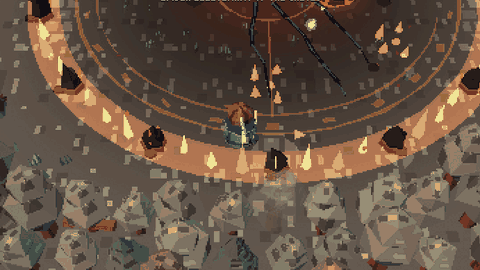

---

## Instruction manual

1. [About the jam](#about-the-jam)
2. [Getting started](#1-getting-started)
3. [Controls](#2-controls)
4. [The story so far](#3-the-story-so-far)
5. [The lands of the kingdom](#4-the-lands-of-the-kingdom)
6. [Fighting](#5-fighting)
7. [The Greyed](#6-the-greyed)
8. [Your gear](#7-your-gear)
9. [The map](#8-the-map)
10. [Talking to people](#9-talking-to-people)
11. [Night, weather and music](#10-night-weather-and-music)
12. [Fishing](#11-fishing)
13. [Bosses](#12-bosses)
14. [Secrets](#13-secrets)
15. [Falling, and the old stones](#14-falling-and-the-old-stones)
16. [Skipping ahead](#15-skipping-ahead)
17. [Running it yourself](#16-running-it-yourself)
18. [How it's built](#17-how-its-built)

---

## About the jam

Simplicity was made for a self-imposed, 72-hour solo game jam. There was no theme; the only rules were the clock and doing it alone.

The goal going in was a whole game, start to credits, rather than a demo: about an hour of story for a player who goes straight from beat to beat, with exploring, fishing and loot-hunting on top for anyone who wants them. That meant keeping the play simple (move, swing, shoot, talk, all on a flat 2D map) and spending the time on the world instead: the look, the city and its people, the fights and the story.

What got made in the 72 hours:

- **A complete story**, from waking on a stone in the woods to the credits, with cutscenes, dialogue and an ending.
- **Twelve areas** across the woods, the capital and what's under it, with interiors you can walk into.
- **Five bosses**, each with its own fight.
- **Real-time combat** with sword and bow against slimes and three schools of mage, with loot, levels and gear that shows on your character.
- **A living capital**: townsfolk with homes, jobs and gossip, doors to knock on, a day and night cycle and weather.
- **Music made up as it plays**, which follows the hour and the weather.
- **No asset packs**: every sprite, palette and the pixel font are text files in this repo, built by the project's own tools, and every 3D model is built in code.

It was built fast and it shows in places. Rough edges are part of the jam.

---

## 1. Getting started

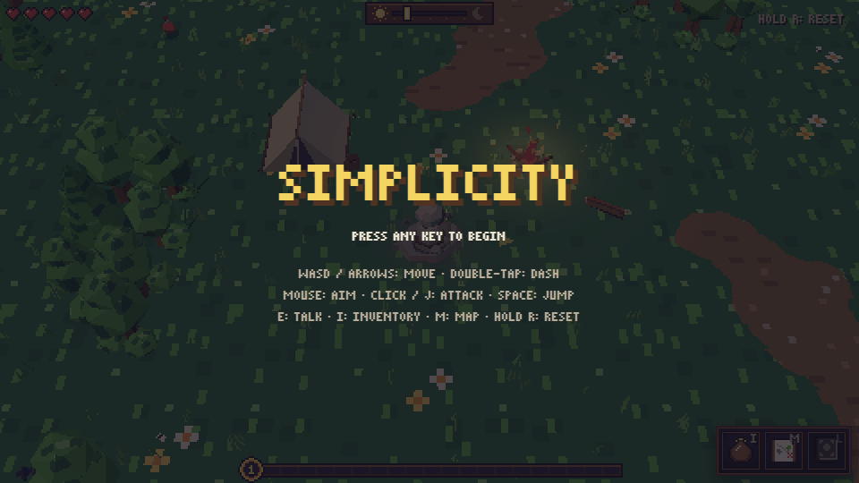

Open the game in a desktop browser (it wants a keyboard and a mouse) and press any key. There's nothing to install and no account; your progress through the story lives in this run, and the run starts over if you reload.

You wake by a campfire in the Witchwood, next to an old stone that glows under your hand.

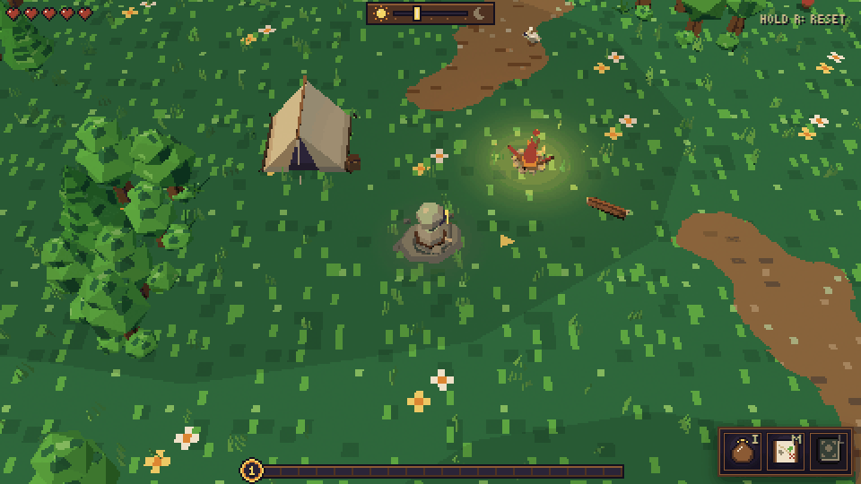

Along the screen's edges:

- **Top left:** your hearts. Run out and you fall.
- **Top middle:** the time of day, sun to moon.
- **Bottom:** your experience bar, with your level in the medallion at its left end.
- **Bottom right:** buttons for the inventory (I), the map (M) and the journal (coming soon).
- **Top right:** a reminder that holding R restarts the run.

## 2. Controls

| Control | Action |
| --- | --- |
| **W A S D** or **arrow keys** | Move |
| Double-tap a direction | Dash (you can't be hurt mid-dash) |
| **Mouse** | Aim |
| **Left click** or **J** | Attack where you aim. With a bow, hold to draw and release to shoot. With a fishing pole, hold to wind up a cast |
| **Space** | Jump |
| **E** (or click them) | Talk to someone, knock on a door, rest, pet an animal |
| **Enter**, **Space** or **E** | Next line, in a conversation |
| **I** or **Tab** | Inventory |
| **M** | Map |
| **N** | Music on or off (it remembers) |
| **Esc** | Close a panel, end a conversation, skip a cutscene |
| Hold **R** | Restart the run |

Walk into water to swim.

## 3. The story so far

You're a stranger in the kingdom, and you can't speak. The way deeper into the Witchwood is barred: the King's woodwardens have staked off the old trail, and nobody goes past without the King's watchword. Robed things have been seen in the woods.

So you go north, through the cave, over the King's Bridge and into the capital, and up to the castle to stand before **King Osric**. He reads the Ranger's note you carry, works out what you are, and asks you for the one thing his frightened kingdom needs: go deep into the Witchwood and kill **Calder**, leader of the Greyed, the mages haunting it.

Listen to what the King tells you. The woodwardens will ask you for the watchword, and you'll have to write it down for them yourself; nothing in the game will write it for you.

## 4. The lands of the kingdom

<table>
<tr>
<td width="50%">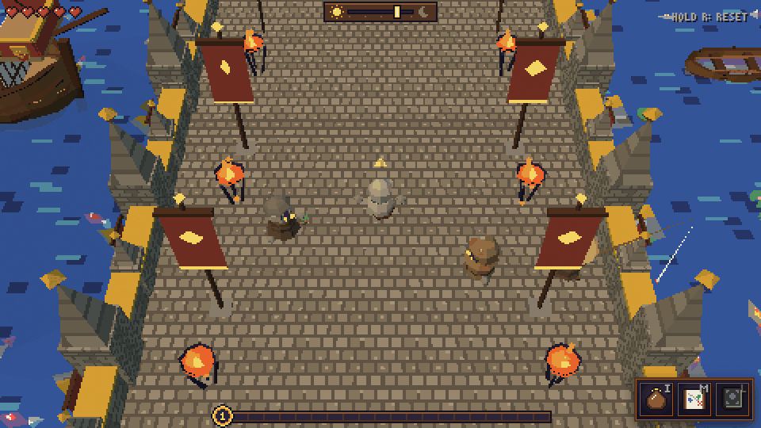<br><b>The King's Bridge.</b> Out of the cave, between gilded lions, and over the great river on a bridge of white marble and gold leaf, to Southgate in the city wall.</td>
<td width="50%">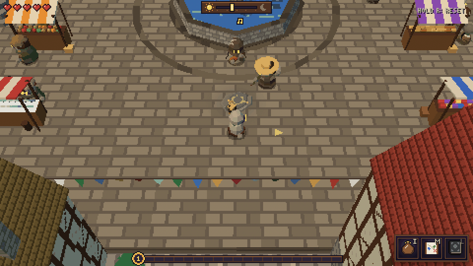<br><b>The Market Quarter.</b> The heart of the capital: the great fountain, the market stalls, St Mary's and St Giles', the inns and the lanes of timber-framed houses.</td>
</tr>
<tr>
<td>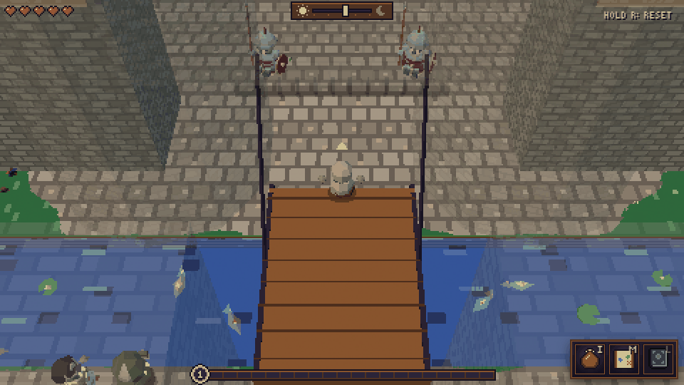<br><b>The Castle.</b> Up Castle Street, over the drawbridge and the moat, and into the ward: the keep, the great hall, the barracks and the smithy.</td>
<td>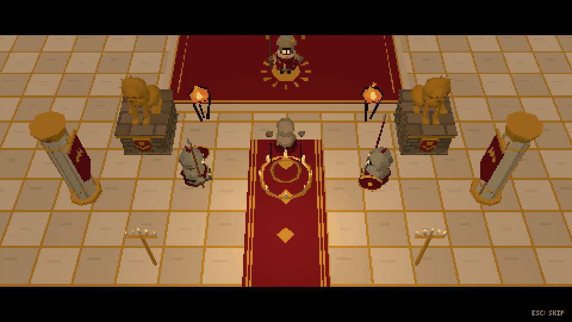<br><b>The Throne Room.</b> Up the keep's stairs: the King on his dais, the Royal Guard along the carpet.</td>
</tr>
<tr>
<td>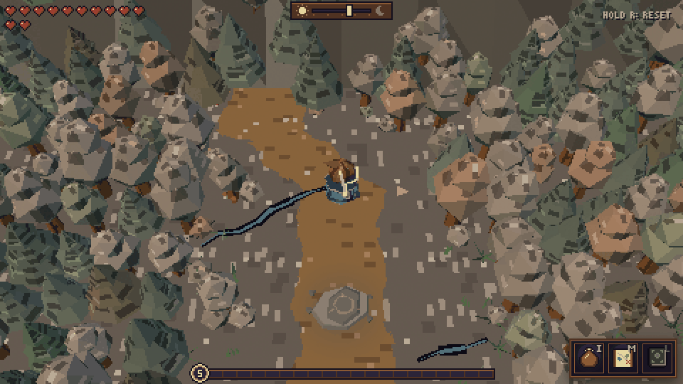<br><b>The Ashwild.</b> Past the barricade, where the trees go ash-grey and cold cracks run across the ground. Ember mages hunt here.</td>
<td>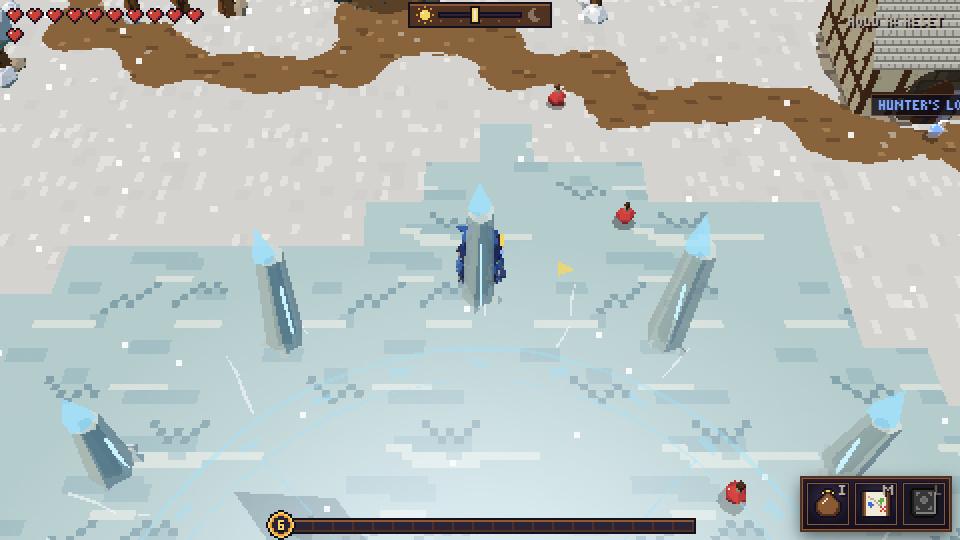<br><b>The Frozen Hollow.</b> A sunken valley where it's always winter, around a frozen lake. Frost mages patrol the ice.</td>
</tr>
<tr>
<td>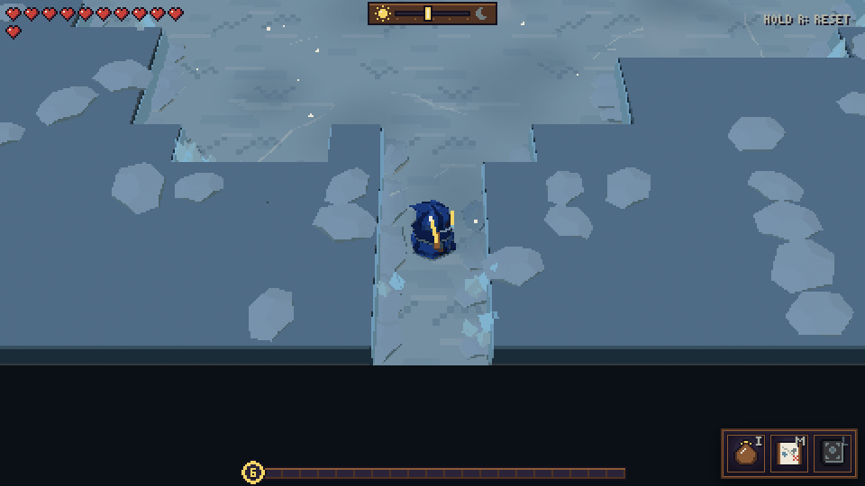<br><b>The Koi Grotto.</b> An ice cave under the Hollow's rim, with a hole cut in the ice. Something very large swims down there.</td>
<td>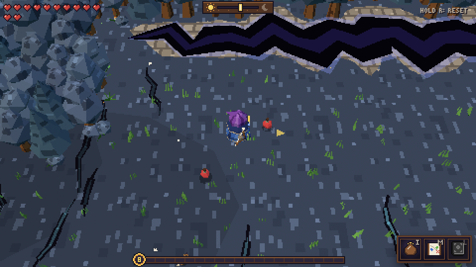<br><b>The Thunder Rift.</b> The oldest trees in the valley, a storm that never stops, and the great crack. Storm mages hold the paths up to it.</td>
</tr>
</table>

There are a few more places besides, off the story path, for whoever goes looking (see [Secrets](#13-secrets)).

Your gear and level travel with you; each area keeps its own creatures.

## 5. Fighting

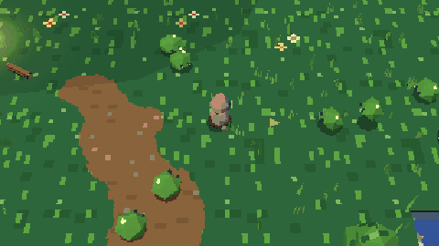

**The sword.** Every attack is a wide swipe that alternates direction and steps you forward. Press again mid-swipe to queue the next one, so mashing chains smoothly. Swipes and dashes feed each other: a dash cancels a swipe at any point, and every swipe resets your dash. Weave them: swipe, dash, swipe, dash.

**The bow.** Hold to draw (you can still walk, at half speed) and release to shoot at the cursor. Only a full draw (0.6 seconds) hits hard: a power shot with a glowing arrowhead. A short draw does at most half your damage, and early on it just flops out onto the grass.

**Critical hits.** Every hit has a 10% chance to crit for double damage, shown as a big gold number with a "!". Some weapons, rings and amulets raise the chance.

**Numbers.** White for your hits, red for damage you take, green for healing, lilac for experience.

**Experience and levels.** Kills give experience (10 for a slime, 50 for a mage). Level up and you're healed fully and grow a little faster and tougher: more life every two levels, more damage every four. The cap is level 20.

**Potions** restore two hearts.

## 6. The Greyed

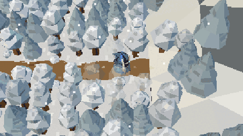

Once you've killed a few slimes, mages start to turn up: robed figures that keep their distance and telegraph every spell with a charge-up in their hands. In the deep woods they're everywhere. There are three schools:

| School | Robes | Watch out for |
| --- | --- | --- |
| **Ember** | Red | Fireballs, and a purple orb that turns you into a sheep for 5 seconds (any damage breaks it) |
| **Frost** | Icy white | Frostbolts that slow you, and **Frost Nova** up close: a ring grows on the ground, and if you're still in it when it goes off, you're frozen solid |
| **Storm** | Indigo and gold | Fast sparks, and **Lightning Strike**: three circles on and around you, lightning a moment later. Keep moving |

Dash or jump through bolts and the nova; only a dash beats lightning. Get close and a mage blinks away. Catch one while its blink is cooling down and it draws a sword and comes for you. Mages grow tougher and more common as you level, and they always drop a magic item or better.

## 7. Your gear

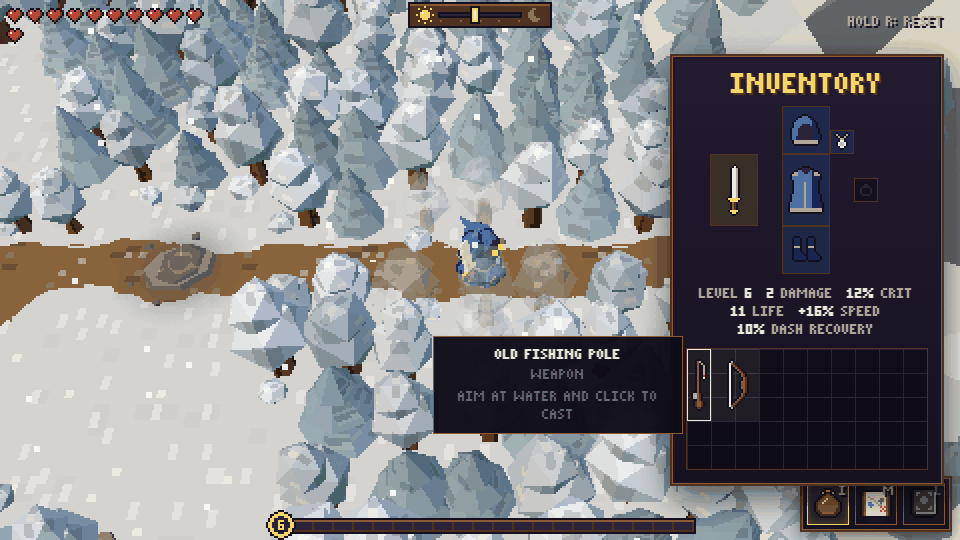

Press **I** (or Tab) for your inventory. Enemies drop loot; walk over it to pick it up.

- **Drag** an item to a cell or an equipment slot, or click to pick it up and click to place it.
- **Right-click** to equip or unequip, or to eat a koi.
- **Drop** an item outside the panel to leave it on the ground.
- **Hover** for a tooltip.
- Drag the panel by its title to move it; it remembers where you put it.

There are six slots: helm, amulet, weapon, armour, ring and boots. Gear adds damage, life, speed, crit chance and faster dash recovery, and every piece shows on your character. You start with nothing on and a plain starter set in your bag: put it on.

## 8. The map

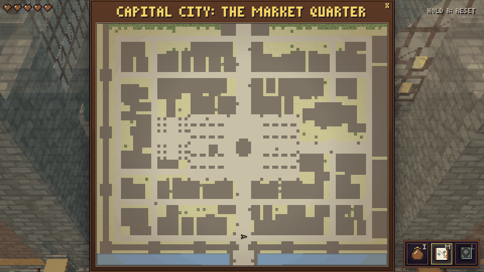

Press **M** for a parchment map of the area you're in, with an arrow for where you are and which way you're facing.

## 9. Talking to people

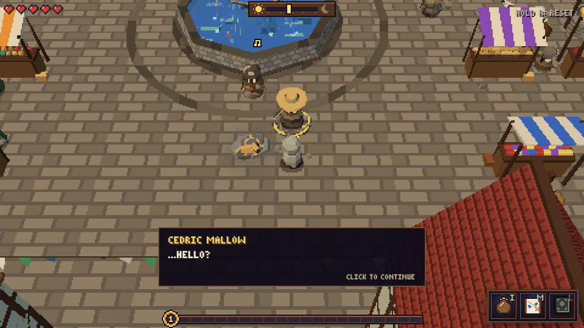

Walk up to someone and press **E**, or click them. Press Enter, Space or E for the next line.

The capital is full of people with homes to go to, work to do and opinions about their neighbours. They'll tell you rumours and gossip, and a few of them have errands for you. Some rumours are worth chasing. Knock on a front door with **E** and see if anyone's home; at the inns of an evening, they might ask you in.

Nothing hostile lives in the city by day.

## 10. Night, weather and music

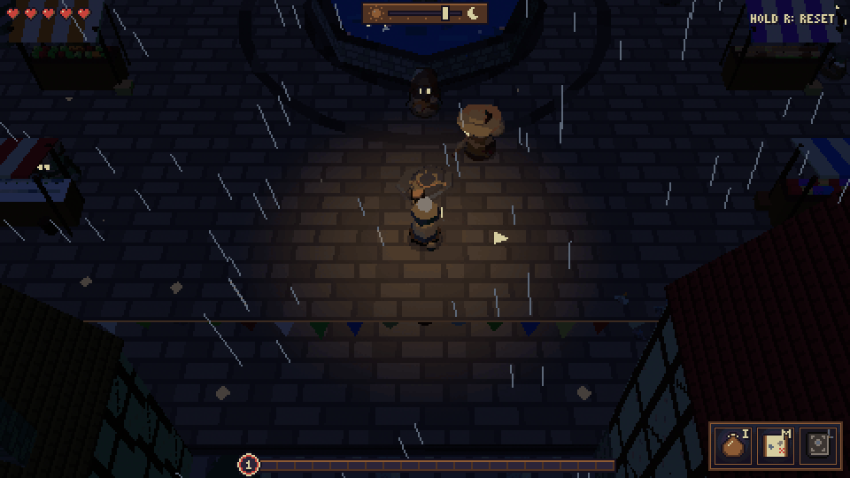

A whole day passes every ten minutes. The light changes through the day, the townsfolk go home at night, and the city after dark isn't quite the same city. Rain and fog roll in and out.

Every area has its own music, made up as it plays, and it follows the hour and the weather: slower, lower and darker by night, a drone under the rain, thin and echoing in fog. Press **N** to turn it off or on.

## 11. Fishing

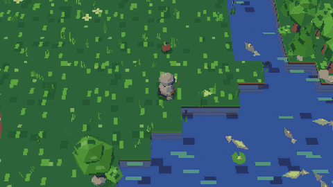

1. Take the **Old Fishing Pole** out of your bag and equip it (right-click it).
2. Hold the left mouse button to wind up. A ring marks where the cast will land; it turns blue over water.
3. Release to cast, up to about 5 tiles away.
4. When the bobber dips and a **!** appears, click within a second to hook the fish.

Catches go in your bag: Pond, Silver and Golden Koi. Right-click one to eat it for 1, 2 or 4 life. Now and then something else comes up on the line.

## 12. Bosses

Each of the Greyed's lieutenants waits at the end of their part of the wood, and when the fight starts, the way out shuts until one of you falls. A health bar appears at the top of the screen.

<table>
<tr>
<td width="50%"><br><b>Cinder, Ember Lieutenant</b> (the Ashwild). The ground erupts under you and walls of fire sweep the circle for you to jump. Bring him low and he steps out through the flames and turns the circle into a furnace.</td>
<td width="50%">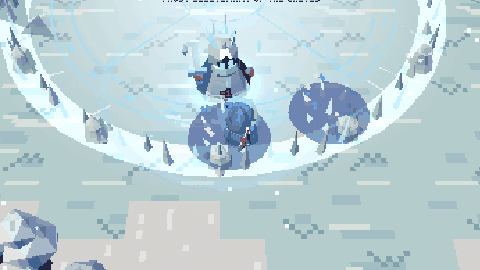<br><b>Rime, Frost Lieutenant</b> (the Frozen Hollow). Frost creeps over the ice under your feet and freezes you if you stand still. Hit her twice in a row and she seals herself in ice or blinks away.</td>
</tr>
<tr>
<td>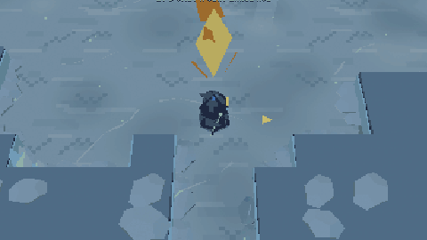<br><b>The Great Koi</b> (the Koi Grotto). Fish through the hole in the ice and see what takes the line. It flops after you in great leaps, slamming down where it lands, and spits fans of freezing water.</td>
<td>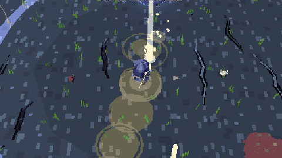<br><b>Calder, Storm Captain</b> (the Thunder Rift). Every shape lightning makes: forking sparks, strikes in lines and stars, iron rods he blinks between. After every blink he stops to earth himself; that's your moment.</td>
</tr>
<tr>
<td>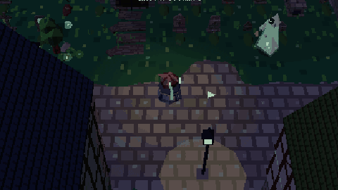<br><b>The Grey Ringer</b> (St Mary's churchyard, after dark). Only if you've heard the rumours. She drifts through walls and gravestones, tolls her bell in a ring you must dash or jump through, and wails wisps after you.</td>
<td>Cinder, Rime and Calder are the story. The Great Koi and the Grey Ringer are optional, and worth it.</td>
</tr>
</table>

## 13. Secrets

Nothing in this section is needed to finish the game, and the game won't point you to any of it. Each is a few minutes off the story path, with a story at the end of it.

### The fairy ring

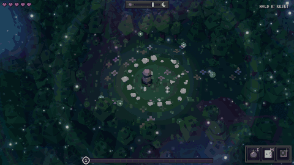

In a glade in the Witchwood there's a ring of pale flowers. By day it's just flowers. Stand in it after dark and the world starts to swim, and the longer you stand still, the deeper it goes: first the woods fade to the fair folk's lights, then the hearts and bars go too, and then they start talking to you. One step and it eases back. If they said anything while you stood there, they leave you something to remember it by: a warm, humming **Fey Acorn**.

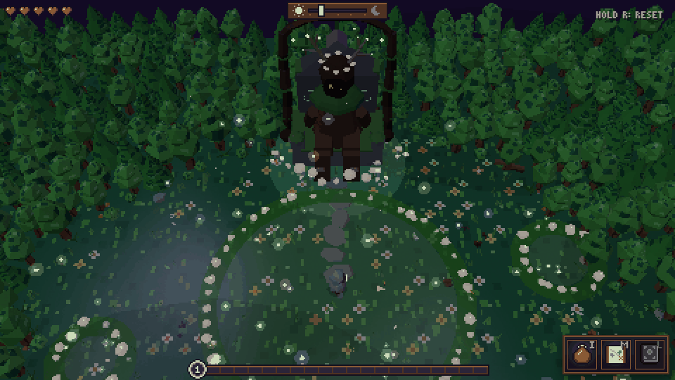

Right-click the acorn in your bag and follow it, and you're taken **Under the Hill**, to a glade under a violet that isn't a sky, before the **Erl-King** on his throne of moss. He has something to tell you, and a gift. Go back and he has a little more to say. Go a third time and the throne is empty. The Hill remembers how many times you've been, even after you start a new run.

### The city after dark

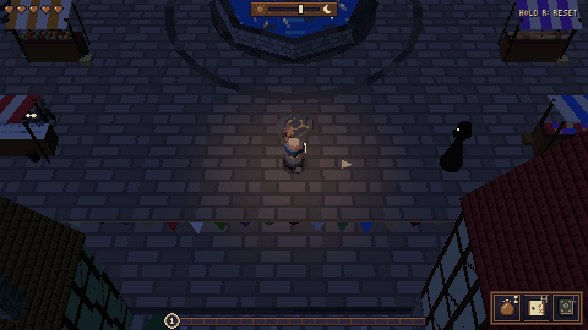

After the curfew bell, Kingsholm's streets empty out, and things start to happen while you walk them alone. A shutter bangs with no one at the window. Footsteps keep pace behind you and stop when you do. A lamp gutters out as you pass and lights again on its own. A well whispers. Someone stands at the end of the street, watching you, and isn't there when you get close. Anyone still out runs for home.

None of it can hurt you, and nothing tells you what just happened: you see it and hear it, or you don't. The watcher isn't only the city's, either. Out in the woods after dark, look at the edge of the trees.

Ask the townsfolk about it in the daytime. Some of them will tell you about the **Dim Man**, a part at a time.

### The curiosities

One catch in ten on your fishing line is something stranger than a koi: a **Little Handbell**, a **Rusted Key**, a **Mysterious Stone**, a **Glass Eye** or a **Sealed Bottle**. Each belongs somewhere in the city, and the townsfolk will notice it in your bag and drop a hint. Take it home and something happens. The bell, for one, is the Grey Ringer's, and she'd like it back.

### St Mary's Undercroft

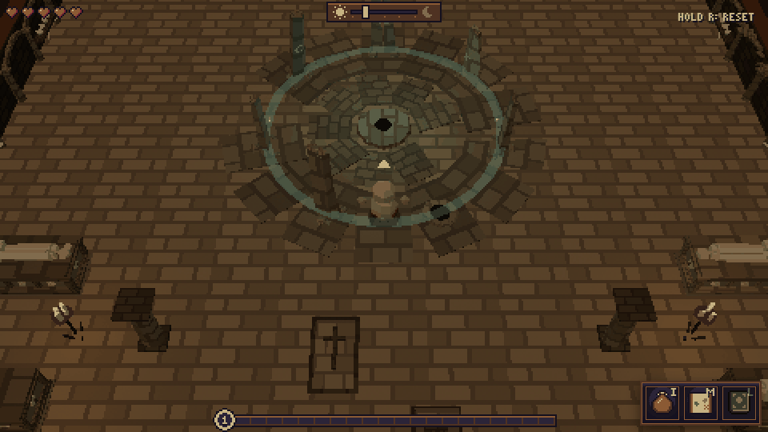

There's a low, locked door at the foot of St Mary's tower, just off the churchyard. The sexton lost the key years ago; if you fish it up, it opens. Down the steps is **the Undercroft**: the church's dead in their chest tombs along the walls, a few candles still burning, and at the far end something much older than the church, a ring of standing stones with one stone missing.

Bring the missing stone home and the ring wakes, and gives you the **Ringstone Pendant**. Wear it to each of the five old stones in the valley and let it drink. Then there's a little door behind the ring, carved with three flames, a snowflake and a lightning bolt, that the masons keep sealing up.

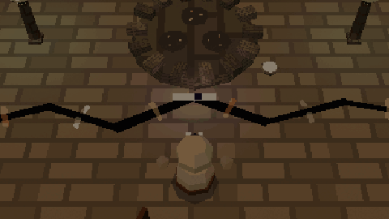

What's behind it is for you to find out.

### How it ends

<details>
<summary><b>Spoilers:</b> the end of the story, and the credits</summary>

<br>

The credits aren't a list of names. They're the story of what happened after, shot by shot, and which shots you get depends on what you did in your run.

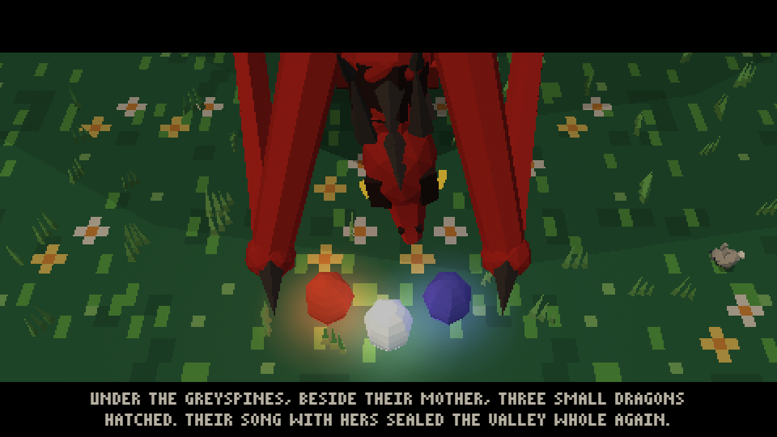


</details>

## 14. Falling, and the old stones

Old, flat, faintly warm stones stand along the way: by the camp, at the fountain, and at the entrance of each part of the deep woods. Touch one and it glows. If you fall, you wake on the last stone you touched with your gear and level kept, though you might lose your potions.

Hold **R** for a second to give up and start the whole run again.

## 15. Skipping ahead

Short on time? A few URL parameters jump straight to the good parts, on the published site too:

| Parameter | What it does |
| --- | --- |
| `?boss=cinder` | Straight into a boss fight, levelled and geared as you'd be by then: `cinder`, `rime`, `koi`, `calder` or `ringer` |
| `&god` | You can't be hurt |
| `&freeze` | The boss stands still |
| `?area=hollow` | Start a fresh run in an area: `witchwood`, `kingsroad`, `capital`, `castle`, `throneroom`, `ashwild`, `hollow`, `grotto`, `rift` (`&entry=stone` for another way in) |
| `?hour=23` | Set the time of day, 0 to 24 |
| `?ending=home` | Watch the ending (spoilers) |

For example: https://dominicabrooks.github.io/Simplicity/?boss=calder&god

## 16. Running it yourself

You need [Node.js](https://nodejs.org) 20 or newer.

```bash
npm ci
npm run dev
```

Then open http://localhost:8123/Simplicity/. The dev server reloads as you edit.

| Command | What it does |
| --- | --- |
| `npm run dev` | Dev server with hot reload |
| `npm run build` | Type-check, then build the site into `dist/` |
| `npm run preview` | Serve the built `dist/` locally |
| `npm test` | Run the tests (Vitest) |
| `npm run e2e` | Play the story's big beats in headless Chromium (Playwright); the first time, `npx playwright install chromium` |
| `npm run typecheck` | TypeScript, strict |
| `npm run lint` | ESLint |
| `npm run format` | Prettier |
| `npm run assets` | Rebuild sprites and the font from `art/`, `palette/` and `font/` (runs automatically before `dev`, `build` and `test`) |

CI runs lint, typecheck, tests and the build on every push and pull request, and every push to `main` that passes republishes the game to GitHub Pages (`.github/workflows/pages.yml`).

## 17. How it's built

TypeScript with an entity-component-system design, rendered with [three.js](https://threejs.org), bundled with Vite. There are no other runtime dependencies. See [ARCHITECTURE.md](ARCHITECTURE.md) for how it fits together, [ART_STYLE.md](ART_STYLE.md) for the look, and [STORY.md](STORY.md) for the hour, beat by beat (spoilers). The world's background is in [LORE.md](LORE.md), [HISTORY.md](HISTORY.md), [HERO.md](HERO.md) and [FAMILIES.md](FAMILIES.md).

- `src/main.ts`: wires everything together and runs the loop
- `src/core/`: the ECS (`World`), a typed event bus, the seeded RNG and math helpers
- `src/data/`: tuning and content as typed tables: player, enemies and spells, items, dialogue, the story's beats
- `src/areas/`: the areas, one module each (the world map is the links between them)
- `src/world/`: tile maps, collision and the city's layouts and residents
- `src/items/`: items, loot rolls and the inventory model
- `src/game/`: components, entity factories, bosses, cutscenes and shared combat rules
- `src/systems/`: gameplay systems (hero, weapons, enemies, mages, spells), run in order by `step()`
- `src/render/`: the low-poly three.js view, from terrain to critters, with one view per kind of entity
- `src/audio/`: the generated music and sound
- `src/ui/`: HUD, inventory, map, dialogue, tooltips and credits
- `tests/`: Vitest specs
- `e2e/`: Playwright specs that play the real game in a browser: the road to the King, his audience, the ghost fight, knocking at doors
- `tools/`: asset builders (`build-sprites.ts`, `build-font.ts`), run with `npm run assets`, and the townsfolk outfit lineup (`/Simplicity/lineup.html` on the dev server)
- `art/`, `palette/`, `font/`: sprite, palette and font sources as text
- `docs/manual/`: the screenshots and clips in this manual
- `docs/contact-sheet.png`: every sprite, built from `art/`
